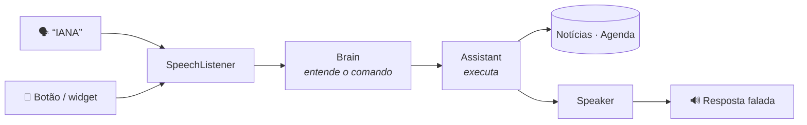

<div align="center">


# IANA

**Assistente pessoal por voz para Android, no estilo Jarvis.**
Você fala, ela entende, executa e responde em voz alta.


</div>

---

## ✨ O que ela faz

| Peça assim | O que acontece |
|---|---|
| *“notícias”* · *“notícias sobre futebol”* | Lê as 5 principais manchetes do Google Notícias |
| *“minha agenda de amanhã”* · *“tenho algo na sexta?”* · *“agenda da semana”* | Lê seus compromissos |
| *“qual meu próximo compromisso?”* | Diz o próximo evento |
| *“marca dentista sexta às 10h”* · *“me lembra de ligar pro contador dia 15 às 3 da tarde”* | Cria o evento na agenda (sincroniza com o Google Agenda) |
| *“que horas são?”* · *“que dia é hoje?”* · *“ajuda”* | O básico |

> 💡 Toque no painel pra falar. Antes do primeiro pedido aparecem atalhos tocáveis, úteis no emulador.

**Mãos livres:** ligue *Ouvir “IANA”* no topo do app. Depois é só dizer **“IANA”**: ela apita, ouve o pedido e responde falando, mesmo com o app fechado e a tela bloqueada.

**Widget:** segure na tela inicial › *Widgets* › **IANA**. Ele mostra a frase motivacional do momento e um botão de microfone pra falar com ela.

**Frases pro Davi:** a tela inicial e o widget mostram uma frase motivacional que troca a cada 3 horas. Pra editar, mude a lista em `assistant/Motivation.kt`.

**Logo:** a logo da SyncForge está em `branding/logo.svg` e, no app, em `res/drawable/ic_logo.xml`. Pra usar outra, gere um vetor a partir do seu SVG no Android Studio (*File › New › Vector Asset › Local file*) e substitua o `ic_logo.xml`.

## 🚀 Rodando no celular

1. Abra o projeto no [Android Studio](https://developer.android.com/studio).
2. No celular, ative as **Opções do desenvolvedor**: *Configurações › Sobre o telefone*, toque 7 vezes em *Número da versão*. Depois ative a **Depuração USB**.
3. Conecte o cabo USB, escolha o aparelho e clique em **Run ▶**.

**Requisitos:** Android 10+ com o app Google instalado (ele fornece o reconhecimento de voz).

<details>
<summary><b>🗣️ Como funciona a palavra “IANA”</b></summary>

A detecção usa o [Vosk](https://alphacephei.com/vosk/), reconhecimento de voz open source (Apache 2.0), sem conta e sem chave. Ele roda no próprio celular.

- Na primeira vez que você liga *Ouvir “IANA”*, o app baixa o modelo de português do Vosk (cerca de 31 MB) e mostra o progresso. Depois disso funciona offline.
- O Vosk procura só a palavra “IANA” e grafias parecidas (“Yana”, “Ana”). Por isso a escuta é leve. Se alguém disser “Ana” perto, ela também pode acordar.
- Pra mudar as palavras, edite `GRAMMAR` e `WAKE` em `WakeWordService.kt`.

</details>

<details>
<summary><b>🎙️ A voz da IANA (feminina, grátis e offline)</b></summary>

A IANA fala com a voz **“dii”**, uma voz feminina em português do Brasil. Ela roda **dentro do próprio app** pelo motor open source [sherpa-onnx](https://github.com/k2-fsa/sherpa-onnx) (Apache 2.0), então é a mesma voz com ou sem internet e não precisa de nenhum outro app.

1. Abra a IANA e toque em **Baixar voz** no aviso do topo. São cerca de 67 MB, baixados uma vez só, com o progresso na tela.
2. Quando terminar, ela fala “Pronto, Davi. Agora esta é a minha voz.”

**Trocar de voz:** toque em *Voz: … Toque para trocar*, no fim da tela, pra escolher entre a voz da IANA e os motores de voz instalados no celular.

**Licença da voz:** o modelo “dii” é CC BY-NC-SA 4.0, livre pra uso pessoal e não comercial.

**Ao compilar:** na primeira sincronização, o Gradle baixa a biblioteca do sherpa-onnx (AAR, cerca de 50 MB) das releases oficiais no GitHub e confere o checksum. Ela fica em `app/libs/`, fora do git.

**Reconhecimento de voz offline:** *Configurações › Google › Pesquisa, Assistente e voz › Voz › Reconhecimento de fala offline* › baixe **Português (Brasil)**.

</details>

## 🧠 Como funciona



```
app/src/main/java/com/davipeter/iana/
├── assistant/   o "cérebro", em Kotlin puro (sem Android)
│   ├── CommandParser.kt   frase → comando
│   ├── DateTimeParser.kt  "sexta às 3 da tarde" → data/hora
│   ├── Assistant.kt       executa o comando e monta a resposta
│   ├── PtBr.kt            datas e horas faladas em português
│   └── Motivation.kt      frases motivacionais
├── data/
│   ├── news/      Google Notícias via RSS (sem chave de API)
│   └── calendar/  agenda do celular (CalendarContract)
├── voice/       ouvir (SpeechListener) e falar (Speaker + EmbeddedVoice, voz “dii” embutida)
├── wakeword/    escuta da palavra “IANA” em segundo plano
├── widget/      widget da tela inicial (frase + botão de falar)
├── ui/          tela em Jetpack Compose (JarvisHud é o painel animado)
└── IanaApp.kt   monta as dependências
```

A interpretação fica atrás da interface `Brain`. Hoje ela usa regras (`RuleBasedBrain`). Pra usar IA, é só criar outra implementação e trocar em `IanaApp.kt`, sem mexer nos comandos.

## 🧪 Testes

O parser, o roteador, o leitor de RSS e as frases têm testes de unidade que rodam na JVM, sem emulador:

```bash
./gradlew test
```

## 🗺️ Próximos passos

- [x] Comando de voz com resposta falada
- [x] Notícias e agenda
- [x] Widget com frase motivacional e botão de falar
- [x] Palavra de ativação “IANA” em segundo plano
- [ ] Resumo falado da manhã (notícias, agenda e DMs pendentes)

---

<sub>Visual com a paleta da SyncForge e a fonte [DM Sans](https://fonts.google.com/specimen/DM+Sans) (SIL Open Font License, veja `licenses/`).</sub>
