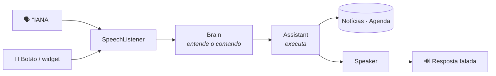

<div align="center">

# IANA

**Assistente pessoal por voz para Android, no estilo Jarvis.**
Você fala, ela entende, executa e responde em voz alta.


</div>

---

## ✨ O que ela faz

| Peça assim | O que acontece |
|---|---|
| *“notícias”* · *“notícias sobre futebol”* | Lê as 5 principais manchetes do Google Notícias |
| *“minha agenda de amanhã”* · *“tenho algo na sexta?”* · *“agenda da semana”* | Lê seus compromissos |
| *“qual meu próximo compromisso?”* | Diz o próximo evento |
| *“marca dentista sexta às 10h”* · *“me lembra de ligar pro contador dia 15 às 3 da tarde”* | Cria o evento na agenda (sincroniza com o Google Agenda) |
| *“que horas são?”* · *“que dia é hoje?”* · *“ajuda”* | O básico |

> 💡 Também dá pra digitar o comando na caixa de texto, o que é útil no emulador.

**Mãos livres:** ligue *Ouvir “IANA”* no topo do app. Depois é só dizer **“IANA”**: ela apita, ouve o pedido e responde falando, mesmo com o app fechado e a tela bloqueada.

**Widget:** segure na tela inicial › *Widgets* › **IANA**. Ele mostra o próximo compromisso e 3 manchetes, se atualiza a cada 30 minutos e tem um botão de microfone pra falar com ela.

## 🚀 Rodando no celular

1. Abra o projeto no [Android Studio](https://developer.android.com/studio).
2. No celular, ative as **Opções do desenvolvedor**: *Configurações › Sobre o telefone*, toque 7 vezes em *Número da versão*. Depois ative a **Depuração USB**.
3. Conecte o cabo USB, escolha o aparelho e clique em **Run ▶**.

**Requisitos:** Android 10+ com o app Google instalado (ele fornece o reconhecimento de voz).

<details>
<summary><b>🗣️ Configurando a palavra “IANA” (uma vez só)</b></summary>

A detecção usa o [Porcupine](https://picovoice.ai/platform/porcupine/), que roda no próprio celular e é grátis para uso pessoal. Você precisa de uma chave e de um arquivo com a palavra treinada:

1. Crie uma conta no [Picovoice Console](https://console.picovoice.ai/) e copie sua **AccessKey**.
2. Na raiz do projeto, abra (ou crie) o arquivo `local.properties` e adicione:
   ```properties
   picovoice.accessKey=SUA_ACCESS_KEY
   ```
   Esse arquivo não vai pro git, então a chave fica só no seu computador.
3. No Console, vá em **Porcupine**, escolha o idioma **Portuguese**, digite **IANA**, treine e baixe para **Android**.
4. Descompacte, renomeie o `.ppn` para **`iana_pt_android.ppn`** e coloque em `app/src/main/assets/`. O modelo de português (`porcupine_params_pt.pv`) já está lá.
5. Rode o app de novo e ligue *Ouvir “IANA”*.

Se a IANA disparar à toa ou não ouvir, ajuste `SENSITIVITY` em `WakeWordService.kt`: mais alto ouve mais fácil, mais baixo erra menos.

</details>

<details>
<summary><b>🎙️ Voz feminina, open source e grátis</b></summary>

A IANA escolhe a voz sozinha, nesta ordem:

1. **VoiceStudio no seu computador**, se configurado e ligado. É a voz com mais qualidade.
2. **Voz offline no celular.** Se houver um motor do sherpa-onnx instalado, ela usa ele; senão, usa a voz padrão do Android.

**Voz offline no celular (recomendado)**

O [sherpa-onnx](https://github.com/k2-fsa/sherpa-onnx) é open source (Apache 2.0) e tem um app de voz que roda no próprio celular, sem internet.

1. Abra a [lista de APKs de voz](https://k2-fsa.github.io/sherpa/onnx/tts/apk-engine.html) no celular.
2. Baixe a versão mais recente terminada em **`arm64-v8a-pt-tts-engine-vits-piper-pt_BR-dii-high.apk`**. A “dii” é uma voz feminina em português do Brasil.
3. Instale e abra o app uma vez. A IANA detecta o motor sozinha, e a tela mostra qual voz está em uso.

**VoiceStudio no computador (opcional)**

O [VoiceStudio](https://voicestudio.sh/pt-BR/) é open source (AGPL) e grátis. Ele roda no computador e expõe uma API compatível com a da OpenAI. O celular precisa estar no mesmo Wi-Fi.

1. Instale e abra o VoiceStudio. A API fica em `http://localhost:3900/v1`.
2. Descubra o IP do computador na rede (ex.: `192.168.0.10`) e coloque no `local.properties`:
   ```properties
   voicestudio.url=http://192.168.0.10:3900
   voicestudio.model=kokoro
   voicestudio.voice=pf_dora
   ```
   `pf_dora` é a voz feminina pt-BR do Kokoro. Confira os nomes de modelo e voz disponíveis na sua instalação em `http://localhost:3900/v1/models`.
3. Se o computador estiver desligado, a IANA usa a voz do celular e só tenta o VoiceStudio de novo depois de 5 minutos.

**Reconhecimento de voz offline:** *Configurações › Google › Pesquisa, Assistente e voz › Voz › Reconhecimento de fala offline* › baixe **Português (Brasil)**.

</details>

## 🧠 Como funciona



```
app/src/main/java/com/davipeter/iana/
├── assistant/   o "cérebro", em Kotlin puro (sem Android)
│   ├── CommandParser.kt   frase → comando
│   ├── DateTimeParser.kt  "sexta às 3 da tarde" → data/hora
│   ├── Assistant.kt       executa o comando e monta a resposta
│   └── PtBr.kt            datas e horas faladas em português
├── data/
│   ├── news/      Google Notícias via RSS (sem chave de API)
│   └── calendar/  agenda do celular (CalendarContract)
├── voice/       ouvir (SpeechListener) e falar (Speaker: VoiceStudio ou voz do celular)
├── wakeword/    escuta da palavra “IANA” em segundo plano
├── widget/      widget da tela inicial (Jetpack Glance + WorkManager)
├── ui/          tela em Jetpack Compose (VoiceOrb é a bola animada)
└── IanaApp.kt   monta as dependências
```

A interpretação fica atrás da interface `Brain`. Hoje ela usa regras (`RuleBasedBrain`). Pra usar IA, é só criar outra implementação e trocar em `IanaApp.kt`, sem mexer nos comandos.

## 🧪 Testes

O parser, o roteador, o leitor de RSS e os dados do widget têm testes de unidade que rodam na JVM, sem emulador:

```bash
./gradlew test
```

## 🗺️ Próximos passos

- [x] Comando de voz com resposta falada
- [x] Notícias e agenda
- [x] Widget com manchetes, próximo compromisso e botão de falar
- [x] Palavra de ativação “IANA” em segundo plano
- [ ] Resumo falado da manhã (notícias, agenda e DMs pendentes)

---

<sub>Fontes: [Bricolage Grotesque](https://fonts.google.com/specimen/Bricolage+Grotesque) e [Onest](https://fonts.google.com/specimen/Onest), sob a SIL Open Font License (veja `licenses/`).</sub>
