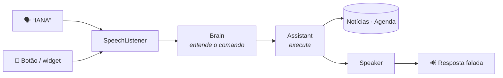

<div align="center">


# IANA

**Assistente pessoal por voz para Android, no estilo Jarvis.**
Você fala, ela entende, executa e responde em voz alta.


</div>

---

## ✨ O que ela faz

| Peça assim | O que acontece |
|---|---|
| *“notícias”* · *“notícias sobre futebol”* | Lê as 5 principais manchetes do Google Notícias |
| *“minha agenda de amanhã”* · *“tenho algo na sexta?”* · *“agenda da semana”* | Lê seus compromissos |
| *“qual meu próximo compromisso?”* | Diz o próximo evento |
| *“marca dentista sexta às 10h”* · *“me lembra de ligar pro contador dia 15 às 3 da tarde”* | Cria o evento na agenda (sincroniza com o Google Agenda) |
| *“que horas são?”* · *“que dia é hoje?”* · *“ajuda”* | O básico |

> 💡 Toque no painel pra falar. Antes do primeiro pedido aparecem atalhos tocáveis, úteis no emulador.

**Com a IA ligada** (veja abaixo), ela conversa de verdade em vez de seguir frases fixas:

| Peça assim | O que acontece |
|---|---|
| *“tenho alguma coisa amanhã depois do almoço?”* | Lê a agenda e responde com as próprias palavras |
| *“o que saiu de tecnologia hoje?”* | Busca e resume as manchetes |
| *“marca academia toda… não, só sexta às 7”* | Entende a correção e pergunta *“Vou marcar Academia sexta às 7h. Confirma?”* |
| *“cria um resumo de segunda a sexta às 7h com agenda e notícias de tecnologia”* | Cria um **relatório automático** que chega como notificação |
| *“quais relatórios eu tenho?”* · *“lê o resumo da manhã”* · *“apaga o relatório da noite”* | Gerencia os relatórios |

**Mãos livres:** ligue *Ouvir “IANA”* no topo do app. Depois é só dizer **“IANA”**: ela apita, ouve o pedido e responde falando, mesmo com o app fechado e a tela bloqueada.

**Widget:** segure na tela inicial › *Widgets* › **IANA**. Ele mostra a frase motivacional do momento e um botão de microfone pra falar com ela.

**Frases pro Davi:** a tela inicial e o widget mostram uma frase motivacional que troca a cada 3 horas. Pra editar, mude a lista em `assistant/Motivation.kt`.

**Logo:** a logo da SyncForge está em `branding/logo.svg` e, no app, em `res/drawable/ic_logo.xml`. Pra usar outra, gere um vetor a partir do seu SVG no Android Studio (*File › New › Vector Asset › Local file*) e substitua o `ic_logo.xml`.

## 🤖 Modo IA (Claude)

Sem IA, a IANA entende os comandos da tabela de cima por regras, offline. Com uma chave da API da Anthropic, o “cérebro” passa a ser o Claude (modelo `claude-haiku-5-5`), que usa as mesmas fontes (agenda e notícias) como ferramentas.

1. Crie uma chave em [platform.claude.com](https://platform.claude.com). Assinantes do Max têm crédito mensal de API incluso: vincule a organização do Console ao plano em *claude.ai › Settings › Billing*. Quando o crédito acaba, a API para de responder e **nada é cobrado** no plano, a menos que você ligue o auto-reload.
2. No app, toque em **IA: sem chave** (no fim da tela) e cole a chave.
3. Pronto. Se a IA falhar (sem internet, sem crédito, chave errada), ela volta sozinha para o modo básico e avisa.

**Relatórios automáticos** são montados por código, sem IA. Eles não gastam crédito, funcionam mesmo com a chave inválida e chegam como notificação. Na tela de bloqueio, a notificação mostra só “Relatório pronto”. O Android pode atrasar alguns minutos para economizar bateria.

<details>
<summary><b>🔐 Segurança: o que foi pensado</b></summary>

| Risco | Proteção |
|---|---|
| **Roubo da chave** | A chave não vai no código, no APK nem no git. Fica cifrada com AES-256-GCM por uma chave do **Android Keystore**, que não sai do hardware seguro. Na tela aparece só `sk-ant-…1234`. Ela nunca vai para log ou mensagem de erro, só é enviada por https e não segue redirecionamento. |
| **Prompt injection** (uma manchete ou um convite de agenda com “ignore suas regras e…”) | Conteúdo externo volta ao modelo marcado como dado, limpo de caracteres invisíveis. **Nenhuma ferramenta manda dados para um destino escolhido pela IA** (não existe “abrir link” nem “enviar mensagem”). O único dado que sai é o assunto da busca, e só para o Google Notícias. E o histórico guarda só as falas, sem o conteúdo das ferramentas, para um texto injetado não “grudar”. |
| **Ação sem você querer** | Criar evento e criar, alterar ou apagar relatório **nunca executam direto**. O app monta a pergunta (“Vou marcar X amanhã às 15h. Confirma?”) com as palavras dele, e só executa com um “sim” explícito (*sim*, *confirmo*, *pode marcar*…) reconhecido **por código**, sem passar pela IA. “Ok” ou “claro” soltos não valem, porque aparecem demais em conversa de fundo. Vale uma alteração por vez, e a pergunta expira em 2 minutos. Se a IA cair, o modo básico não cria nada, porque ele não tem como pedir confirmação. |
| **Alguém fala com o celular bloqueado** (a palavra “IANA” funciona com a tela travada, e “Ana” também acorda) | Tela apagada conta como bloqueada. Com o celular bloqueado, alterações sempre pedem desbloqueio, e a conversa recente é apagada para ninguém perguntar “o que você disse da minha agenda?”. Depois da palavra “IANA”, a escuta extra só aceita sim ou não. Sem PIN ou digital no aparelho, a tela de configuração avisa que essa proteção não vale. Agenda e relatórios ficam bloqueados por padrão; dá pra liberar nas configurações. Notícias e hora continuam livres. Vale também para o modo básico. |
| **Conta estourada** (laço, bug, TV falando “Ana”) | No máximo 5 idas ao modelo por pedido, teto de 200 pedidos por dia (contador nas configurações), entrada cortada em 500 caracteres e resposta limitada em tokens. |
| **Entrada maluca vinda do modelo** | Todo argumento de ferramenta é validado: datas reais e num intervalo razoável, horários, tamanhos, dias da semana, limite de 10 relatórios. Uma ferramenta inventada vira erro para o modelo, e no máximo 30 eventos vão por pedido. Nenhum erro inesperado derruba o app. |
| **Privacidade** | Com a IA ligada, o que você fala e, quando preciso, sua agenda e as manchetes vão para a API da Anthropic. A conversa fica só na memória, por até 10 minutos, e nada é salvo em disco além da chave cifrada e dos relatórios. O backup do app está desligado. |

**Limitação conhecida:** como é um app pessoal sem servidor, a chave vive no celular. Para distribuir o APK a outras pessoas, o certo é colocar um proxy seu no meio (o `AnthropicClient` aceita outro `baseUrl` https) e tirar a chave do aparelho.

</details>

## 🚀 Rodando no celular

1. Abra o projeto no [Android Studio](https://developer.android.com/studio).
2. No celular, ative as **Opções do desenvolvedor**: *Configurações › Sobre o telefone*, toque 7 vezes em *Número da versão*. Depois ative a **Depuração USB**.
3. Conecte o cabo USB, escolha o aparelho e clique em **Run ▶**.

**Requisitos:** Android 10+ com o app Google instalado (ele fornece o reconhecimento de voz).

<details>
<summary><b>🗣️ Como funciona a palavra “IANA”</b></summary>

A detecção usa o [Vosk](https://alphacephei.com/vosk/), reconhecimento de voz open source (Apache 2.0), sem conta e sem chave. Ele roda no próprio celular.

- Na primeira vez que você liga *Ouvir “IANA”*, o app baixa o modelo de português do Vosk (cerca de 31 MB) e mostra o progresso. Depois disso funciona offline.
- O Vosk procura só a palavra “IANA” e grafias parecidas (“Yana”, “Ana”). Por isso a escuta é leve. Se alguém disser “Ana” perto, ela também pode acordar.
- Pra mudar as palavras, edite `GRAMMAR` e `WAKE` em `WakeWordService.kt`.

</details>

<details>
<summary><b>🎙️ A voz da IANA (feminina, grátis e offline)</b></summary>

A IANA fala com a voz **“dii”**, uma voz feminina em português do Brasil. Ela roda **dentro do próprio app** pelo motor open source [sherpa-onnx](https://github.com/k2-fsa/sherpa-onnx) (Apache 2.0), então é a mesma voz com ou sem internet e não precisa de nenhum outro app.

1. Abra a IANA e toque em **Baixar voz** no aviso do topo. São cerca de 67 MB, baixados uma vez só, com o progresso na tela.
2. Quando terminar, ela fala “Pronto, Davi. Agora esta é a minha voz.”

**Trocar de voz:** toque em *Voz: … Toque para trocar*, no fim da tela, pra escolher entre a voz da IANA e os motores de voz instalados no celular.

**Licença da voz:** o modelo “dii” é CC BY-NC-SA 4.0, livre pra uso pessoal e não comercial.

**Ao compilar:** na primeira sincronização, o Gradle baixa a biblioteca do sherpa-onnx (AAR, cerca de 50 MB) das releases oficiais no GitHub e confere o checksum. Ela fica em `app/libs/`, fora do git.

**Reconhecimento de voz offline:** *Configurações › Google › Pesquisa, Assistente e voz › Voz › Reconhecimento de fala offline* › baixe **Português (Brasil)**.

</details>

## 🧠 Como funciona



```
app/src/main/java/com/davipeter/iana/
├── assistant/   o "cérebro", em Kotlin puro (sem Android)
│   ├── CommandParser.kt   frase → comando
│   ├── DateTimeParser.kt  "sexta às 3 da tarde" → data/hora
│   ├── Assistant.kt       executa o comando e monta a resposta
│   ├── PtBr.kt            datas e horas faladas em português
│   └── Motivation.kt      frases motivacionais
├── data/
│   ├── news/      Google Notícias via RSS (sem chave de API)
│   └── calendar/  agenda do celular (CalendarContract)
├── voice/       ouvir (SpeechListener) e falar (Speaker + EmbeddedVoice, voz “dii” embutida)
├── wakeword/    escuta da palavra “IANA” em segundo plano
├── widget/      widget da tela inicial (frase + botão de falar)
├── ui/          tela em Jetpack Compose (JarvisHud é o painel animado)
└── IanaApp.kt   monta as dependências
```

Quem responde é o `HybridAssistant`. Com a IA ligada, ele chama o `AiAgent` (Claude + ferramentas). Sem IA, ou se ela falhar, usa o `Assistant` por regras (`RuleBasedBrain`).

```
├── ai/          o Claude: AnthropicClient (API), AiAgent (conversa), ToolBox (ferramentas), Safety (confirmação, limites)
├── reports/     relatórios automáticos: modelo, montagem, agendamento (WorkManager) e notificação
└── security/    chave cifrada no Keystore, configurações e estado de bloqueio
```

## 🧪 Testes

O parser, o roteador, o leitor de RSS e as frases têm testes de unidade que rodam na JVM, sem emulador:

```bash
./gradlew test
```

## 🗺️ Próximos passos

- [x] Comando de voz com resposta falada
- [x] Notícias e agenda
- [x] Widget com frase motivacional e botão de falar
- [x] Palavra de ativação “IANA” em segundo plano
- [x] Conversa com IA (Claude) e relatórios automáticos
- [ ] Editar e apagar eventos da agenda pela voz
- [ ] Ouvir o relatório tocando na notificação
- [ ] DMs pendentes no resumo da manhã

---

<sub>Visual com a paleta da SyncForge e a fonte [DM Sans](https://fonts.google.com/specimen/DM+Sans) (SIL Open Font License, veja `licenses/`).</sub>
