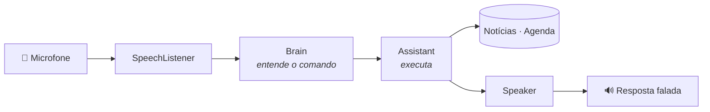

<div align="center">

# IANA

**Assistente pessoal por voz para Android, no estilo Jarvis.**
Você fala, ela entende, executa e responde em voz alta.


</div>

---

## ✨ O que ela faz

| Peça assim | O que acontece |
|---|---|
| *“notícias”* · *“notícias sobre futebol”* | Lê as 5 principais manchetes do Google Notícias |
| *“minha agenda de amanhã”* · *“tenho algo na sexta?”* · *“agenda da semana”* | Lê seus compromissos |
| *“qual meu próximo compromisso?”* | Diz o próximo evento |
| *“marca dentista sexta às 10h”* · *“me lembra de ligar pro contador dia 15 às 3 da tarde”* | Cria o evento na agenda (sincroniza com o Google Agenda) |
| *“que horas são?”* · *“que dia é hoje?”* · *“ajuda”* | O básico |

> 💡 Também dá pra digitar o comando na caixa de texto, o que é útil no emulador.

## 🚀 Rodando no celular

1. Abra o projeto no [Android Studio](https://developer.android.com/studio).
2. No celular, ative as **Opções do desenvolvedor**: *Configurações › Sobre o telefone*, toque 7 vezes em *Número da versão*. Depois ative a **Depuração USB**.
3. Conecte o cabo USB, escolha o aparelho e clique em **Run ▶**.

**Requisitos:** Android 10+ com o app Google instalado (ele fornece o reconhecimento de voz).

<details>
<summary><b>🎙️ Deixando a voz melhor e funcionando offline</b></summary>

- **Reconhecimento offline:** *Configurações › Google › Pesquisa, Assistente e voz › Voz › Reconhecimento de fala offline* › baixe **Português (Brasil)**.
- **Voz da IANA:** *Configurações › Acessibilidade › Saída de texto para voz* › mecanismo Google, idioma **Português (Brasil)**. Ali dá pra escolher outras vozes.

</details>

## 🧠 Como funciona



```
app/src/main/java/com/davipeter/iana/
├── assistant/   o "cérebro", em Kotlin puro (sem Android)
│   ├── CommandParser.kt   frase → comando
│   ├── DateTimeParser.kt  "sexta às 3 da tarde" → data/hora
│   ├── Assistant.kt       executa o comando e monta a resposta
│   └── PtBr.kt            datas e horas faladas em português
├── data/
│   ├── news/      Google Notícias via RSS (sem chave de API)
│   └── calendar/  agenda do celular (CalendarContract)
├── voice/       ouvir (SpeechListener) e falar (Speaker)
├── ui/          tela em Jetpack Compose
└── IanaApp.kt   monta as dependências
```

A interpretação fica atrás da interface `Brain`. Hoje ela usa regras (`RuleBasedBrain`). Pra usar IA, é só criar outra implementação e trocar em `IanaApp.kt`, sem mexer nos comandos.

## 🧪 Testes

O parser, o roteador e o leitor de RSS têm testes de unidade que rodam na JVM, sem emulador:

```bash
./gradlew test
```

## 🗺️ Próximos passos

- [x] Comando de voz com resposta falada
- [x] Notícias e agenda
- [ ] Widget com manchetes, próximo compromisso e botão de falar
- [ ] Palavra de ativação “Jarvis” em segundo plano
- [ ] Resumo falado da manhã (notícias, agenda e DMs pendentes)
